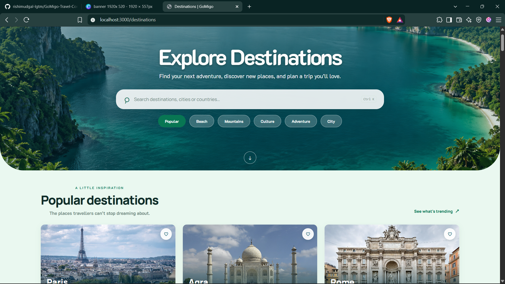
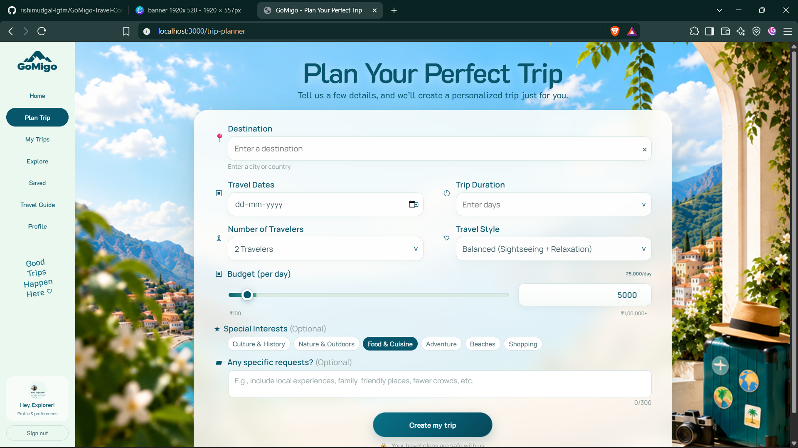
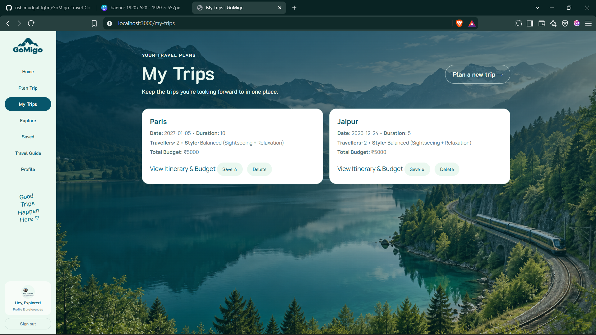
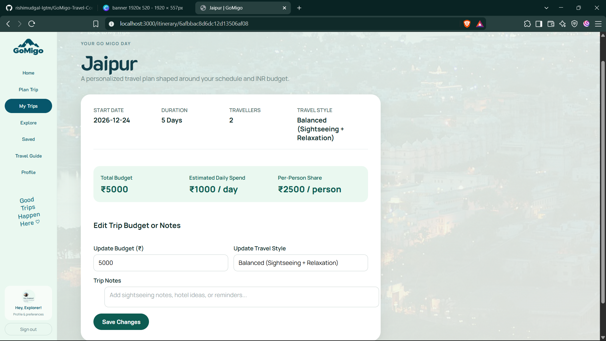

# GoMigo — Travel Planner

GoMigo is a student web project for discovering destinations and organizing personalized trips. Visitors can explore a curated destination catalog, enter trip details, review saved plans, and see a simple INR budget breakdown.

The app uses server-rendered pages and a light, teal travel-focused design. It is a course prototype, not a production booking service.

## Screenshots

### Destination discovery

Browse popular places and search or filter the destination catalog.



### Trip planner

Enter a destination, dates, trip length, group size, budget, and travel style.



### My trips

Review saved plans and open an itinerary or manage a trip.



### Itinerary and budget

View trip details with estimated per-day and per-traveller budget figures.



## Features

- Destination catalog with category filtering and local destination photography
- Trip creation, editing, bookmarking, and deletion
- My Trips and Saved pages backed by MongoDB
- Itinerary view with estimated daily and per-traveller INR costs
- Landing, Explore, Travel Guide, Profile, Sign In, and Sign Up pages
- Responsive layouts built with HTML, CSS, and vanilla JavaScript

## Technology

- Node.js and Express
- Handlebars templates (`.hbs`)
- MongoDB and Mongoose
- HTML, CSS, and vanilla JavaScript

## Run locally

### Requirements

- Node.js and npm
- A MongoDB database, such as MongoDB Atlas

### Setup

1. Install dependencies:

   ```bash
   npm install
   ```

2. Create a `.env` file in the project root:

   ```env
   PORT=3000
   MONGO_URI=mongodb+srv://<username>:<password>@<cluster-url>/gomigo?retryWrites=true&w=majority
   ```

3. Seed the destination catalog if the database is empty:

   ```bash
   node seed.js
   ```

4. Start the app:

   ```bash
   npm run dev
   ```

5. Open [http://localhost:3000](http://localhost:3000).

`npm start` runs the server without watch mode. Keep `.env` private and do not commit database credentials.

## Main pages and trip routes

| Method | Path | Purpose |
| --- | --- | --- |
| `GET` | `/` | Landing page |
| `GET` | `/destinations` | Public destination catalog |
| `GET` | `/explore` | App destination discovery page |
| `GET` | `/trip-planner` | Trip planning form |
| `POST` | `/trips` | Create a trip |
| `GET` | `/my-trips` | List trips |
| `GET` | `/saved` | List bookmarked trips |
| `GET` | `/itinerary/:id` | View an itinerary and budget estimates |
| `POST` | `/trips/:id/update` | Update a trip |
| `POST` | `/trips/:id/save` | Toggle a trip bookmark |
| `POST` | `/trips/:id/delete` | Delete a trip |

## Project structure

```text
config/          MongoDB connection
controllers/     Page rendering and trip actions
models/          Mongoose models for destinations, trips, and users
public/          Stylesheets, browser JavaScript, and image assets
routes/          Express page and form routes
views/           Handlebars page templates
docs/screenshots/README screenshots
seed.js          Destination catalog seeding script
server.js        Express application entry point
```

## Prototype note

The Sign In and Sign Up routes are demonstration flows; they do not implement session-based authentication or password hashing. Use fictional demo credentials only. Trip records are not tied to individual user accounts.
